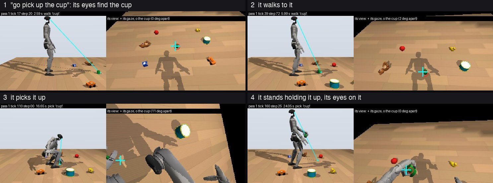

# one-life-g1

**A robot brain raised from birth by a parent's hands, in one continuous life.** NB2, a simulated Unitree G1 humanoid born
2026-10-25, lives in one room with one teacher; it learns every tick and sleeps every night. Since 2026-10-27 she raises it through
numbered workshops: she moves its body through a skill until it does the skill alone, and she talks to it.

<p align="center"></p>

**Told "go pick up the cup" and then "put it in the bucket", with the toys it knows on the floor, it finds the cup with its own eyes,
walks to it, picks it up, carries it to the bucket 1 to 2 m on and puts it in, with no help.** In two tests of 15 independent passes
on 2026-10-30 (the cup, the block, the duck, the car and the can, three seeds each) it put the toy in the bucket 14 of 15 and 12 of 15
times. It picked up the duck and the car before it had ever held either, from what it had been told they are like ("round and small",
"square and small"), and a new toy, the can, after hearing its name and a description. Everything here is simulation: one brain, one
seed, one room.

## Where it stands now (2026-10-30)

**The workshops** (`docs/LEVELS.md`, `tools/levels/`). Since 2026-10-27 the rule is the owner's: the parent only moves its body (her
hands walk it, squat it, close its hand) and never writes into its brain, with no labels, no forced acts and no part switched off.
Small learned layers below the brain take each movement over by repetition, and her share falls as they do.

- **Workshops 1 and 2:** walked into a red circle, then a longer way. **Workshops 3 to 10:** eight toys named to it, flashcard
  fashion, until it says each name back.
- **Workshops 11 to 13:** picked up off the floor, the block and then the cup; then the test: every toy it knows on the floor,
  `go pick up the <toy>`, no hands.
- **Workshops 14 to 16:** a thing it has never picked up. She describes each toy while it looks at it ("the cup is round and
  small"). Asked for a toy it has never held, it recalls where to stop, which side to come up on and how to grip from the toy it is
  most like. A new toy, the can: its name taught alone first, then described, then asked for.
- **Its eyes on the thing, and Workshop 17:** its eyes are held on the toy through the reach, the grasp and the lift, and the
  pick-up now ends with the toy held up before its eyes.
- **Its own seeing, and Workshops 18 to 25:** the toys' places, shapes and looks from its own colour camera, no longer the
  simulator's record (`body/sim/seen.py`); put down (19), the bucket (22), and the chain, `go pick up the <toy>` then `put it in the
  bucket` (24, 25).
- **Workshop 26 and the first stage, reliable alone:** the carry made longer and turned, every toy practised in turn inside the whole
  chain (practising one part or one toy alone broke the others, three times). The chain by itself, 15 independent single passes:
  14 of 15, then 12 of 15 on three new seeds. Its own hand over the car hid the car from its eyes and its reach homed short; a thing
  its own arm cuts in front is no longer a whole sighting (A288), and the car went 0 of 3 to 3 of 3.
- **The language workshops (from 2026-10-30 night):** its body held still, pictures before its eyes, her talk. A new seeing pathway
  learned from scratch (`body/sim/what.py`, A289), taught from real photos (COCO) and sim pictures of scanned real objects on
  photographed floors (`tools/levels/lessons.py`), each word's meaning found across her lines; tested only on pictures never shown,
  real and sim apart and crossed. L1 and L2 are under way (`docs/LEVELS.md`).

| asked, with every toy it knows on the floor | lifted (dry tests, 2026-10-29) |
|---|---|
| "go pick up the cup" | 10 of 10 |
| "go pick up the car" | 10 of 10 |
| "go pick up the block", "the duck", "the can" | 5 of 5 each |
| the duck, before it had ever held it | 5 of 5 |
| the car, before it had ever held it | 3 of 5; 4 of 5 once its reach aimed at the car's middle |
| the can, a new toy, after its name and a description | 5 of 5 |

The last three rows were measured before Workshop 17 had it practise those toys.

| `go pick up the <toy>`, then `put it in the bucket`, by itself | in the bucket (15 independent passes, 2026-10-30) |
|---|---|
| the cup, the block, the duck, the car, the can; seeds 2-4 | 14 of 15 |
| the same, seeds 5-7 | 12 of 15 (the car 0 of 3) |
| with A288 (its own hand over a thing hides it), seeds 2-4 | 13 of 15; the car on seeds 5-7, 3 of 3 |

## How it learns now

`docs/ARCHITECTURE.md` opens with the whole child on one page: the brain and the layers below it, what each does and learns from.

- **Below the brain, from her hands.** The legs' and the arms' layers (the walk's gait and the arms' carriage), the stance, the eye
  layer (which things to look at, and which word goes with which thing: `body/sim/gaze_layer.py`), the pace and steering toward a
  held goal (`pace_layer.py`, `goal_layer.py`), learned movements run off once started (`moves.py`; the pick-up, `pickup.py`) and
  their starts (`start_layer.py`), the words it learns from her speech and what is said of each thing (`word_forms.py`,
  `concepts.py`), its seeing (`seen.py`). Each learns from her hands at the share she pushes with. `docs/SIM_DESIGN.md`, entries
  A230 to A288, has each one, with its sources and the measurements that justified it.
- **Its what pathway** (`what.py`, A289): codes for what its eyes rest on, learned from scratch, and the words that go with them,
  found across her lines; taught in picture lessons, not yet read by the layers that act.
- **The brain** is unchanged (next section). Its own reward learning has not yet taken any of these skills over: so far they are
  the layers' imitation of her hands.

## What is inside the brain

Read `docs/ARCHITECTURE.md` for the whole of it in ordinary machine-learning terms. In brief:

- **A predictive model** over the stream of senses and symbols, trained online from its own error, all day.
- **A key-value memory** that writes surprising and rewarded moments harder and replays them at night.
- **Critics at several time scales**, fast ones by discounted TD learning and slow ones by average-reward TD learning. The error of a
  four-second head is the learning signal for action.
- **A policy per effector**, learned by policy gradient with eligibility traces, from that one signal.
- **Reward**: her face and a lever she presses, plus its own pain, plus two small intrinsic terms, novelty and competence.
- **Nights**: the day's episodes replayed in proportion to their surprise and reward; the model, the memory and the policies
  consolidated; the physics run so the limbs' forward models keep learning.

```
surprise   s_t = 1 − cos(p_{t−1}, e(x_t))
reward     r_t = face_t + lever_t + pain_t + novelty_t + competence_t
critic     δ_t = r_t + γ V(s_t) − V(s_{t−1})                    (slow heads: r_t − r̄ + V(s_t) − V(s_{t−1}))
policy     e_t = γ e_{t−1} + ∇ log π(a_t | z_t);   W ← W + α δ_t e_t
night      P(replay an episode) ∝ mean(s · (1 + |δ|)) / its running mean
```

## What is said and what is not

- One seed. One room. One teacher program. Simulation only. No comparison runs.
- The workshops' skills come from the layers below the brain copying her hands, not from the brain's reward loop.
- **Its seeing is its own but simple.** The layers that choose a toy and aim the reach read its place, shape and look from its own
  colour camera, by a thing's colour standing out from the floor: enough for bright toys on a plain floor, not for a cluttered room.
  The what pathway learned from real photos is meant to replace it.
- Her words reach it as sound and as a token channel; on a real robot a speech recognizer would give the same tokens.
- The chain's tests are 15 independent single passes, each from the brain as saved (a run of several passes learns between them, and
  a fall in one pass wrote the next one's balance). The pick-up's earlier tests were runs of 5 or 10 passes; with the toy at a new place
  and turn each pass (ten places, 0.9 to 1.6 m away, up to 18° to either side) its eyes ended on the toy asked for 50 of 50 times and
  it lifted it 45 of 50 (`docs/LEVELS.md`).
- Open at this writing: a toy squeezed out between thumb and finger at the top of the lift (the duck, once in 15); a cup it stopped
  too far from to reach; the picture lessons' crossed test (a word taught from sim pictures only, named in real photos) is the hard
  one.
- Every constant in the body is sourced in `docs/SIM_DESIGN.md` or marked there as ours, and the ledger records every change to the
  body or the teacher with the day it landed and the measurement that justified it.

## The workshops, in order

`docs/CURRICULUM.md` is the route: the workshops 1 to 50 in order, each one's command, its bar, what NB2 needed to reach it, and the
rules every workshop keeps; a new or bigger model can be taken through the same ones. `tools/levels/workshop1.py` is the shared workshop (the walk, the name, the find, the pick and the put tasks, the chain, her hands,
the pushes, the frames and the record); `workshop2.py` to `workshop28.py` are the workshops, and `workshop13.py` is the test. They start
from NB2's brain (about 1 GB), which is not published. The language workshops' picture lessons are `tools/levels/lessons.py`; their
pictures are fetched and rendered by `photos_fetch.py` (COCO), `sim_pictures.py` (the scanned objects) and `rooms_fetch.py` (the rooms'
floors, CC0 from Poly Haven), none of them published. `docs/LEVELS.md` records every run, what each one taught and every brain sent back.

## The record and the design

- `docs/LEVELS.md` is the workshops' record. `docs/SIM_DESIGN.md` is the ledger: the design, the decision log, and every dated change
  (1.9 MB; read it raw). `docs/RIG_SPEC.md` is the plan for the same life on a real G1. `docs/README.md` indexes the rest.
- A life writes `ticks.jsonl` (one row a tick) and `nights.jsonl` (one row a night); `tools/measure/sim_rulers.py` reads them. A
  workshop writes `passes.jsonl` and each pass's `ticks.jsonl` and frames.

## Run the workshops

From the repository root, after `. tools/live/nb2_config.sh` (NB2's switches, `$CFG`), with a brain in `data/workshops/brain` (NB2's is
not published; a newborn's first days: `tools/live/start_nb2.sh`):

```bash
python3 tools/levels/workshop26.py --out data/workshops/workshop26/run1 --ask cup --passes 2 --cfg $CFG   # a workshop's run (it saves)
tools/levels/test_chain.sh mytest                    # the chain test: every toy, three seeds, one pass each, her hands off
tools/levels/rounds.sh 26 1 again 2                  # practice rounds of the whole chain, every toy in turn
python3 tools/levels/lessons.py --lesson 2 --days 40 --to-bar   # the picture lessons (Workshop 30), to their bar
python3 tools/levels/workshop_view.py                # the live view: http://127.0.0.1:8046/
```

Each pass writes its record (`ticks.jsonl` a row a tick, frames two a tick) and `tools/levels/pass_digest.py` reads it whole: its
outcome and why in a line, and its moments on one sheet (`digest.json`, `moments.jpg`).

## Tests and pins

Tests are plain functions under `body/tests/` (`tools/README.md` shows how to run one). Behaviour is guarded by a pinned digest:
`tools/measure/determinism_check.py --profile sim` lives a tiny G1 body on a fixed script and hashes every weight, memory and feeling,
and `tools/measure/pins/digests.txt` keeps every pin taken and why it moved (re-taken 2026-10-30 over the workshops' body). The tests of
the workshops' layers and of the what pathway pass (2026-10-30). The project's rule is targeted tests and the pin as the gate.

## Map

- `body/core/` the brain · `body/sim/` the world, the G1, her body and her teaching (`body/sim/lang/`), and the layers below the
  brain (`moves.py`, `pickup.py`, `gaze_layer.py`, `goal_layer.py`, `pace_layer.py`, `start_layer.py`, `word_forms.py`,
  `concepts.py`, `arms.py`, `legs.py`, `seen.py`, `what.py`; the rooms' looks `looks.py`) · `body/tests/` the suites
- `tools/levels/` the levels and the workshops (`docs/LEVELS.md`) · `tools/harness/` the box task and its expert · `tools/live/` the
  newborns' start scripts and the live page · `tools/measure/` the guard and its pin, the sim's instruments (`tools/README.md` is the index)
- `docs/` the architecture, the curriculum, the workshops' record, the ledger, NB2's pre-registration and its first day ·
  `assets/` the tokenizer and the images

## Roadmap

The curriculum's next blocks (`docs/CURRICULUM.md`), each workshop run to its bar on things never shown:

1. **Language of things** (Workshops 29 to 39): names, the same kind in different looks, what things are like, one and two, where
   things are (in, on, under, next to), kinds of kinds, what happens (from videos), who did what to what, saying what it sees; from real
   photos and videos and the sim's, its body held still.
2. **Tasks told and shown once** (Workshops 40 to 44): known tasks in new words, new combinations of thing, action and place, a task
   watched once and done, a new action learned by watching and her hands.
3. **Robust in real-looking homes** (Workshops 45 to 50): pushes, floors and weights varied; rooms photographed from real homes and
   scanned real toys; stop, no and wait; looking around for a thing and around what is in the way; getting up; tidying up.
4. **A real G1** (`docs/RIG_SPEC.md`), in stages: its senses first, then walking on the robot's own gait, then picking up, on a tether.

Earlier chapters of the same architecture (a first life, pretraining runs, a first newborn) are history, not this life: their records
are in `docs/archive/` and the releases up to 0.210.0.

## License

Apache 2.0. See `LICENSE` and `NOTICE`.
