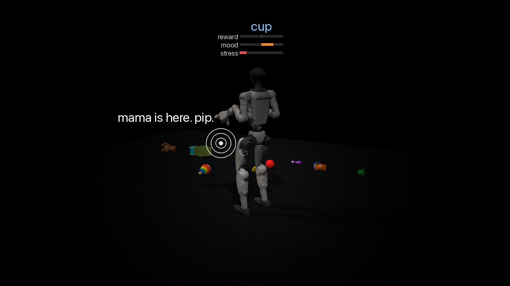
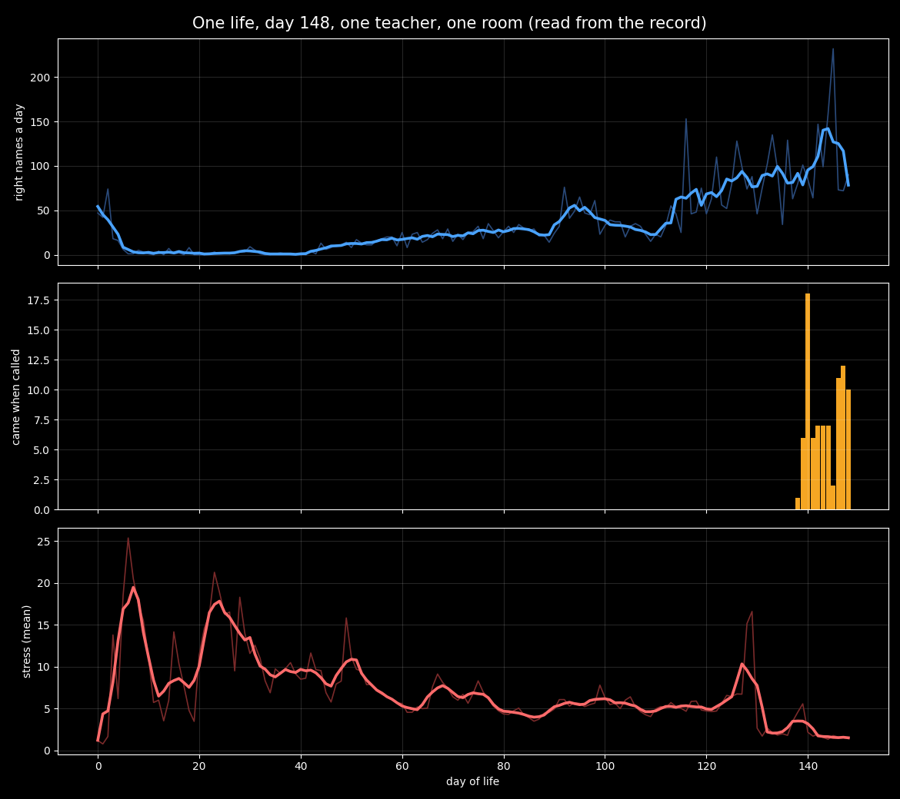

# one-life-g1

**A robot brain that learns in one continuous life, from a few declared reflexes and Unitree's walking controller.** A simulated
Unitree G1 humanoid lives in one room with one teacher. It has no dataset and no task reward. Its one reward is her approval, read
from her face, plus its own pain. It learns every tick, sleeps every night, and has never been reset. At this writing it has lived
148 days on one Mac.

**Start here:** [`docs/OVERVIEW.md`](docs/OVERVIEW.md), two pages: what it is, how it learns, what it has learned, and how to check it.
<!-- FILM: the 60-second film's link goes here once it is published (the film itself is never in git) -->

<p align="center"></p>

Over those days it learned, from hearing words while looking at things and from her approval, to name the toy in front of it: seventy
to ninety times a day by day 148, from almost none across days 6 to 43 (its first days' hits were its born words, babbled hundreds of
times a day). Measured against chance, the grounding is real and modest: when it says a toy's name, that toy is in view 1.44 times as
often as when its own words are shuffled within the day. It looks where she asks, and has begun to spell a word nobody put in its mouth.
When she calls it from behind it walks to her; that approach is a born reflex steering the gait, and the brain taking it over is an
open ruler.

<p align="center"></p>

## Replay it yourself

One command downloads a saved checkpoint of the life (about 1.1 GB), replays 1,500 ticks of it and prints the rulers. Five to ten
minutes on a laptop CPU; no GPU, no speech engine (her voice comes from the checkpoint's own cache).

```bash
git clone https://github.com/LukeHamond1001/one-life-g1.git && cd one-life-g1
pip install -r requirements.txt
sh tools/replay.sh
```

`requirements.txt` pins the versions the life ran on (Python 3.14, torch 2.12.0, MuJoCo 3.9.0). Exact replay depends on them: other
versions run, but floating point may differ and the replay then drifts from the record.

The default checkpoint is a moment on day 147, saved mid-day. In the 1,500 ticks that followed it in the life, it named five toys
right, and she called it from behind three times and it walked to her each time (the approach is a born reflex steering Unitree's
gait). A mid-day checkpoint replays as a **sibling** of the life, not a copy: a little of her state is not in the save (an open item, listed in `docs/README.md`),
so the day diverges after a few ticks. In our replay of it she called three times and it came twice, stood 22 times and stepped 52.

`TAG=dawn-148 sh tools/replay.sh` replays the dawn of day 148 instead, and that replay is **exact**: with the life's own thread count
(4) and the checkpoint's own voice, ticks 7,104,001 to 7,105,500 reproduced the life's record tick for tick, every judgment, every
event her eyes saw, every word it said. A pair saved at a dawn carries her whole state because the night begins it afresh. In those
ticks it lies on its back and plays; the comings come later in the day (`TICKS=24000` replays the whole of it, about two hours).
Across machine architectures floating point may differ; `tools/determinism_check.py --profile sim` prints a digest two machines can
compare.

## What it does, by its own rulers

Every number the project reports is read from the life's record by `tools/sim_rulers.py` (the chart above by
`tools/sim_growth.py`, its numbers in `assets/growth_curve.tsv`). Days 146 to 148:

| ruler | a day |
|---|---|
| names the toy in front of it correctly (learned: its voice's choice, from words heard while looking) | 72 to 90 (232 on day 145, a day of its birth-word toys) |
| the toy it names is in view, against chance (its own toy words shuffled within each day; days 110 to 148, 42,237 words; `tools/sim_naming_chance.py`) | 20.3 % against 14.1 % (1.44×), above chance on 38 of 39 days |
| comes when called from behind (a born approach reflex steering the gait since day 138; not yet the brain's own command) | 10 to 12 |
| looks at the toy she asks for | 2 |
| spells a word it was never given, letter by letter ("box") | 2 |
| pain, as a share of ticks | 0.7 % |
| nights slept, each with the whole night on | 148 |

What it cannot do yet: speak in two-word phrases; walk by its own gait (the gait is Unitree's); leave the room (the door is the next
experiment); see her face from pixels (her expression reaches it as a signed channel from a born face reader).

## What is inside

Read `docs/ARCHITECTURE.md` for the whole of it in ordinary machine-learning terms. In brief:

- **A predictive model** over the stream of senses and symbols, trained online from its own error, all day.
- **A key-value memory** that writes surprising and rewarded moments harder and replays them at night.
- **Critics at several time scales**, fast ones by discounted TD learning and slow ones by average-reward TD learning. The error of a
  four-second head is the learning signal for action.
- **A policy per effector**, learned by policy gradient with eligibility traces, from that one signal.
- **One reward: her approval**, read from her face, plus its own pain, plus two small intrinsic terms, novelty and competence, each a fraction of a smile.
- **Nights**: the day's episodes replayed in proportion to their surprise and reward; the model, the memory and the policies
  consolidated; the physics run so the limbs' forward models keep learning. No ablations: every night of the life has run whole.
- **Below the brain**, declared and listed: a few built-in reflexes, a born face reader, and Unitree's gait controller taking the
  brain's speed and heading. That command port is the only new wiring a real robot would need.

```
surprise   s_t = 1 − cos(p_{t−1}, e(x_t))
reward     r_t = face_t + pain_t + novelty_t + competence_t
critic     δ_t = r_t + γ V(s_t) − V(s_{t−1})                    (slow heads: r_t − r̄ + V(s_t) − V(s_{t−1}))
policy     e_t = γ e_{t−1} + ∇ log π(a_t | z_t);   W ← W + α δ_t e_t
night      P(replay an episode) ∝ mean(s · (1 + |δ|)) / its running mean
```

## What is said and what is not

- One seed. One room. One teacher program. Simulation only. No comparison runs: the body is measured by its own rulers over its own days.
- Walking is Unitree's controller under the brain's command. Turning toward her face and the first approach are born reflexes.
- Her words reach it as sound and as a token channel; it speaks on that channel.
- Every constant in the body is sourced in `docs/SIM_DESIGN.md` or marked there as ours.
- The design ledger records every change to the body or the teacher with the day it landed and the measurement that justified it.

## The record and the design

- `docs/OVERVIEW.md` is the two-page introduction. `docs/SIM_DESIGN.md` is the ledger, for the record: the design, the decision log, and every dated change since birth (1.3 MB; read it raw).
- `docs/DEMO_CLAIM.md` is the claim card. `docs/README.md` indexes the rest.
- A life writes `ticks.jsonl` (one row a tick: her judgments, what her eyes saw, its posture, pain, stress, the word it hears, the
  word it says) and `nights.jsonl` (one row a night). `tools/sim_rulers.py` reads them. The field named `word` is her channel, what the
  child hears; the child's own speech is `token`.

## Run a new life

```bash
sh tools/get_gait.sh      # Unitree's walking policy, fetched from their repository and checked
python3 tools/sim_life.py --out data/newborn --days 1 --d 512 --seed 1 --voice fake --threads 4 --room door --extra book_box_bucket --page
```

`--page` serves a live view at `http://127.0.0.1:8030/` in the studio view: the robot and its toys on a dark floor, her voice drawn
where it comes from, its own words in blue, and its reward, mood and stress above its head. The room and the teacher's body are
left out of the picture, not out of the physics: she still lifts it and hands it toys, and its eyes still see her. `--film DIR`
saves the same view as frames (`--view-size 1920x1080` for full HD). `--voice real` uses the
macOS speech engine; `--voice fake` is tones. A day is 24,000 ticks, about 2.5 hours on an M-series Mac at this size, and the night
that follows it about 40 minutes. Resume with `--resume`.

## Tests and pins

Tests are plain functions under `body/tests/`: `pip install -r requirements-dev.txt`, then `python3 -m pytest body/tests -q`, about an
hour on an M-series Mac (`tools/README.md` shows how to run one). Of 469 tests, 53 are known failures, each marked an expected failure
with its reason in `body/tests/conftest.py` and grouped in `docs/README.md`: the teacher's staged scenarios from before her room's table
moved and its door opened, refactor-era invariants that later documented changes moved, six world tests overtaken the same way, and two
open defects. Behaviour is guarded by pinned digests: `tools/determinism_check.py` lives a tiny body on a fixed script and hashes every
weight, memory and feeling; `tools/pins/digests.txt` keeps every pin ever taken and why it moved. The project's rule since September is
targeted tests and the pins as the gate, not suite gates; the known failures stay in the tree until each is fixed or rewritten.

## Map

- `body/core/` the brain · `body/sim/` the world, the G1, her body and her teaching (`body/sim/lang/`) · `body/tests/` the suites
- `tools/` the life, the replay, the rulers, the pins · `docs/` the ledger and the architecture · `assets/` the tokenizer and the images
- `legacy/` the two earlier lives of the architecture: the one-token organism (2026-08) and the language body (2026-09), kept as they were

## Roadmap

1. In simulation: the brain's own command takes over the walk; two-word speech; the door onto a second room.
2. On a GPU workstation: the same life, larger and faster, with deeper nights.
3. On a real G1: her face from a camera, the command port on the real gait, nights on the workstation, the rulers published every day.

## License

Apache 2.0. See `LICENSE` and `NOTICE`.
